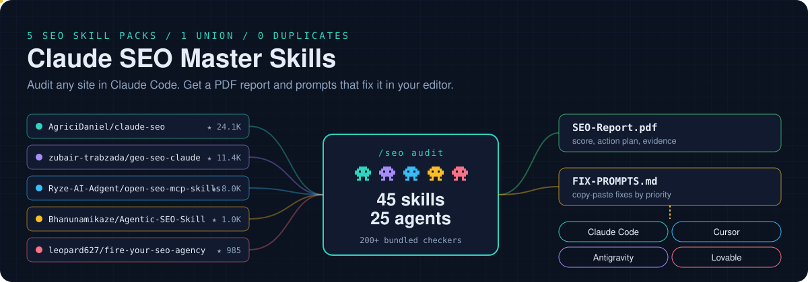
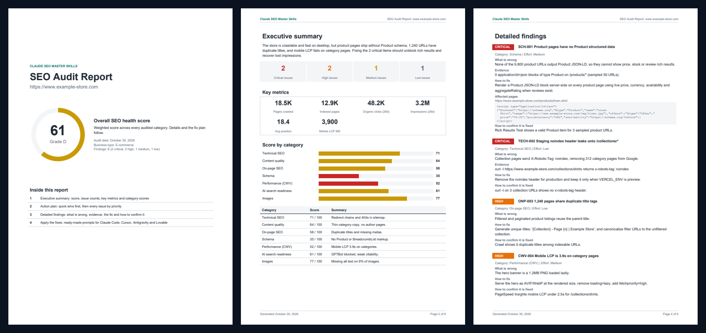
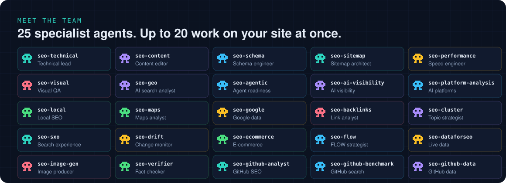
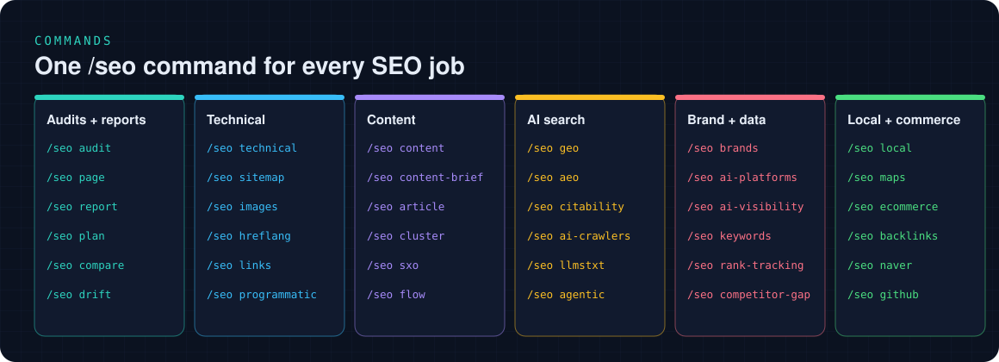

<!--
  Claude SEO Master Skills: the best of five open-source SEO skill packs for Claude Code, merged into one plugin.
  Technical SEO, Core Web Vitals, E-E-A-T, Schema.org, AI search (GEO, AEO), local, e-commerce, GitHub and Naver SEO.
  45 sub-skills and 25 specialist agents. PDF reports and AI fix prompts. MIT licensed.
-->



<h1 align="center">Claude SEO Master Skills</h1>

<p align="center">
  <b>Five of the best open-source SEO skill packs, merged into one.</b> For Claude Code, Codex, Cursor, Antigravity and Kiro.<br />
  Audit any site, get a client-ready PDF, then paste the fixes into Claude Code, Cursor, Antigravity or Lovable.
</p>

<p align="center">
  <a href="#install">Install</a> ·
  <a href="#what-you-get">What you get</a> ·
  <a href="#fix-it-with-ai">Fix prompts</a> ·
  <a href="#meet-the-team">Team</a> ·
  <a href="#commands">Commands</a> ·
  <a href="#what-came-from-where">Sources</a> ·
  <a href="#faq">FAQ</a>
</p>

<p align="center">
  <a href="https://claude.com/product/claude-code"></a>
  
  <a href="LICENSE"></a>
  
  
  
  <a href="https://github.com/ankushpanday33/Claude-Seo-Master-Skills"></a>
</p>

**Claude SEO Master Skills is a free SEO skill pack for Claude Code, OpenAI Codex, Cursor, Google Antigravity and Kiro.** Give it any website and it runs a full audit with up to 20 specialist agents in parallel, then hands you three things:

1. **`SEO-Report.pdf`**: a clean report you can send to a client or your boss. Health score, issues by priority, evidence for every finding and a way to check each fix.
2. **`FIX-PROMPTS.md`**: ready-to-paste prompts that make the fixes for you in **Claude Code, Cursor, Google Antigravity or Lovable**.
3. **`seo-findings.json`**: every finding as data, so the next audit can show what changed.

It is a **union** of five popular open-source projects. Where two projects covered the same check, the best version was kept and the missing pieces from the others were merged in. Where only one project had something, it was added as is. Nothing duplicated, nothing useful dropped.

It checks everything a good SEO consultant would:

- **Technical SEO.** Crawlability, indexing, sitemaps, robots.txt, redirects, canonicals, security headers, JavaScript rendering, Core Web Vitals (LCP, INP, CLS).
- **Content quality.** E-E-A-T, thin and duplicate content, readability, freshness, topical coverage.
- **Structured data.** Finds, validates and writes Schema.org JSON-LD for rich results.
- **AI search (GEO and AEO).** Citability of every passage, AI crawler access, llms.txt, brand mentions, and readiness for Google AI Overviews, ChatGPT, Perplexity, Gemini and Copilot.
- **Growth data.** Keyword research, rank tracking, competitor gaps and backlinks, from your own Search Console data when connected.
- **Local, e-commerce, international, GitHub and Naver.** Google Business Profile, product pages, hreflang, repository SEO and Korea's Naver search.

## What you get

Run `/seo audit https://yoursite.com` and the audit folder fills up with a PDF like this:



<details>
<summary><b>Inside the PDF</b></summary>
<br />

| Section | What is in it |
|---|---|
| Cover | Overall SEO health score (0 to 100) with grade, business type, finding counts |
| Executive summary | Issue counts by priority, key metrics (US format: 48.2K, 3.2M), score bar for every category |
| Action plan | Quick wins first, then every issue grouped Critical, High, Medium, Low with effort |
| Detailed findings | What is wrong, the evidence seen on the live site, affected pages, how to fix it (with code), how to confirm it is fixed |
| Apply the fixes | Which prompt file to use in which AI tool |

Every page has the skill name in the header and "Page X of Y" in the footer. Try it without auditing anything:

```bash
./scripts/claude-seo run master_report.py --demo --output-dir demo-report/
```

</details>

## Fix it with AI

A report alone does not fix anything. Every audit also writes `FIX-PROMPTS.md` plus one file per tool in `fix-prompts/`:

| Tool | File | How to use it |
|---|---|---|
| **Claude Code** | `fix-prompts/claude-code.md` | Run `claude` in your project folder and paste prompt 1, then the next |
| **Cursor** | `fix-prompts/cursor.md` | Open the project, start an Agent chat, paste one prompt at a time |
| **Google Antigravity** | `fix-prompts/antigravity.md` | Start an agent task in the Agent Manager, paste one prompt at a time |
| **Lovable** | `fix-prompts/lovable.md` | Paste each short prompt into the project chat and check the preview |

Prompts are batched by priority (Critical and High first), know your tech stack (detected from the site: Next.js, Shopify, WordPress, Webflow, Lovable and more), name the files most likely to change, include the reference snippet, and end with a check so you know each fix worked.

<details>
<summary><b>See a real prompt</b>: Claude Code, part 1</summary>

```text
You are fixing SEO issues found by an audit of https://www.example-store.com (part 1 of 3, critical and high priority).
Tech stack: Framework: Next.js 15 (App Router); Hosting: Vercel; CMS: Shopify (headless)
Work in this repository. Read the relevant files before editing.

Rules:
- Fix only the items below. Do not refactor unrelated code or change visible design.
- Server-render every SEO tag (title, meta, canonical, JSON-LD) so it is in the HTML without JavaScript.
- Keep structured data truthful: JSON-LD must match what is visible on the page.
- If an item does not apply to this codebase, say so instead of guessing.

### 2. [Critical] Staging noindex header leaks onto /collections/* (TECH-002)
Problem: Collection pages send X-Robots-Tag: noindex, removing 312 category pages from Google.
Evidence from the live site: curl -I https://www.example-store.com/collections/shirts returns x-robots-tag: noindex
Likely files: `next.config.js`, `middleware.ts`
Required change: Remove the noindex header for production and keep it only when VERCEL_ENV is preview.
Done when: curl -I on 3 collection URLs shows no x-robots-tag header.
...
```

Lovable gets shorter, plain-language batches of 4 because it works chat-first.

</details>

## Meet the team



<details>
<summary><b>All 25 agents</b></summary>
<br />

| Agent | Role | Comes from |
|---|---|---|
| `seo-technical` | Technical SEO lead | claude-seo + Agentic-SEO-Skill + geo-seo-claude |
| `seo-content` | Content editor (E-E-A-T) | claude-seo + Agentic-SEO-Skill + geo-seo-claude |
| `seo-schema` | Structured data engineer | claude-seo + Agentic-SEO-Skill + geo-seo-claude |
| `seo-sitemap` | Sitemap architect | claude-seo + Agentic-SEO-Skill |
| `seo-performance` | Performance engineer | claude-seo + Agentic-SEO-Skill |
| `seo-visual` | Visual QA | claude-seo + Agentic-SEO-Skill |
| `seo-geo` | AI search analyst | claude-seo + geo-seo-claude + fire-your-seo-agency |
| `seo-ai-visibility` | AI visibility (citability, crawlers, brand) | geo-seo-claude |
| `seo-platform-analysis` | Per-engine AI readiness | geo-seo-claude |
| `seo-agentic` | Agent readiness | claude-seo |
| `seo-local` | Local SEO | claude-seo + Agentic-SEO-Skill |
| `seo-maps` | Maps analyst | claude-seo |
| `seo-google` | Google data (GSC, CrUX, GA4) | claude-seo |
| `seo-backlinks` | Link analyst | claude-seo + open-seo-mcp-skills + Agentic-SEO-Skill |
| `seo-cluster` | Topic strategist | claude-seo |
| `seo-sxo` | Search experience | claude-seo |
| `seo-drift` | Change monitor | claude-seo |
| `seo-ecommerce` | E-commerce specialist | claude-seo + Agentic-SEO-Skill |
| `seo-flow` | FLOW strategist | claude-seo |
| `seo-dataforseo` | Live data (extension) | claude-seo |
| `seo-image-gen` | Image producer (extension) | claude-seo |
| `seo-verifier` | Fact checker: dedupes findings, drops unsupported claims | Agentic-SEO-Skill |
| `seo-github-analyst` | GitHub repository SEO | Agentic-SEO-Skill |
| `seo-github-benchmark` | GitHub search benchmark | Agentic-SEO-Skill |
| `seo-github-data` | GitHub data collector | Agentic-SEO-Skill |

</details>

**Built for:**

- **SEO agencies and freelancers** who want an unbranded PDF on the first call and a prompt file the client's developer can run the same day.
- **Founders and marketers on Lovable, Cursor or Claude Code** who want SEO fixed in their own codebase without hiring anyone.
- **In-house teams** who want the same checklist every time, AI search included.

## Commands



<details>
<summary><b>Audits and reports</b> (8 commands)</summary>
<ul><li><code>/seo setup</code>: Create the isolated Python runtime and Chromium</li><li><code>/seo doctor</code>: Check runtime readiness</li><li><code>/seo audit &lt;url&gt;</code>: Full audit, then PDF + fix prompts</li><li><code>/seo page &lt;url&gt;</code>: Deep single-page analysis</li><li><code>/seo report [findings.json]</code>: Build the PDF and fix prompts from any audit</li><li><code>/seo plan &lt;type&gt;</code>: Strategic SEO plan (saas, local, ecommerce, publisher, agency)</li><li><code>/seo compare &lt;audit-a&gt; &lt;audit-b&gt;</code>: Month-over-month score delta</li><li><code>/seo drift baseline | compare | history &lt;url&gt;</code>: Catch SEO regressions after deploys</li></ul>
</details>
<details>
<summary><b>Technical SEO</b> (7 commands)</summary>
<ul><li><code>/seo technical &lt;url&gt;</code>: 10 categories including server performance and page weight</li><li><code>/seo sitemap &lt;url | generate&gt;</code>: Analyze or generate XML sitemaps</li><li><code>/seo images &lt;url&gt;</code>: Image SEO and file optimization</li><li><code>/seo hreflang &lt;url&gt;</code>: International SEO</li><li><code>/seo links &lt;url&gt;</code>: Internal links, orphans, anchors, broken links</li><li><code>/seo programmatic &lt;url&gt;</code>: Pages at scale without thin content</li><li><code>/seo google [command]</code>: Search Console, PageSpeed, CrUX, Indexing, GA4</li></ul>
</details>
<details>
<summary><b>Content</b> (7 commands)</summary>
<ul><li><code>/seo content &lt;url&gt;</code>: E-E-A-T and content quality</li><li><code>/seo content-brief &lt;topic&gt;</code>: Brief with keywords, outline, questions to answer</li><li><code>/seo article &lt;url&gt;</code>: Blog and article SEO</li><li><code>/seo cluster &lt;keyword&gt;</code>: SERP-based topic clusters</li><li><code>/seo sxo &lt;url&gt;</code>: Search experience: page type, personas</li><li><code>/seo flow [stage]</code>: FLOW framework prompts</li><li><code>/seo competitor-pages &lt;url&gt;</code>: "X vs Y" and alternatives pages</li></ul>
</details>
<details>
<summary><b>AI search</b> (8 commands)</summary>
<ul><li><code>/seo geo &lt;url&gt;</code>: Generative Engine Optimization hub</li><li><code>/seo aeo &lt;url&gt;</code>: Featured snippets, People Also Ask, knowledge panel</li><li><code>/seo citability &lt;url&gt;</code>: Citability score 0 to 100 with passage rewrites</li><li><code>/seo ai-crawlers &lt;url&gt;</code>: GPTBot, OAI-SearchBot, ClaudeBot, PerplexityBot access matrix</li><li><code>/seo llmstxt &lt;url | generate&gt;</code>: Validate or generate llms.txt</li><li><code>/seo ai-platforms &lt;url&gt;</code>: Readiness per AI engine</li><li><code>/seo agentic &lt;url&gt;</code>: Agent readiness, WebMCP</li><li><code>/seo schema &lt;url&gt;</code>: Detect, validate, generate JSON-LD</li></ul>
</details>
<details>
<summary><b>Brand and growth data</b> (7 commands)</summary>
<ul><li><code>/seo brands &lt;brand&gt;</code>: Mentions on the sources AI engines cite</li><li><code>/seo ai-visibility &lt;brand&gt;</code>: AI visibility from real data</li><li><code>/seo keywords &lt;seed&gt;</code>: Keyword research from Search Console</li><li><code>/seo rank-tracking</code>: What moved, from Search Console positions</li><li><code>/seo competitor-gap &lt;domain&gt;</code>: Keyword and content gaps</li><li><code>/seo vs-ads</code>: Paid and organic overlap</li><li><code>/seo backlinks &lt;url&gt;</code>: Moz, Bing, Common Crawl, Search Console links</li></ul>
</details>
<details>
<summary><b>Local, commerce, GitHub, Naver, agencies</b> (8 commands)</summary>
<ul><li><code>/seo local &lt;url&gt;</code>: Google Business Profile, NAP, reviews, map pack</li><li><code>/seo maps [command]</code>: Geo-grid rank tracking</li><li><code>/seo ecommerce &lt;url&gt;</code>: Product pages, categories, faceted navigation</li><li><code>/seo github &lt;owner/repo&gt;</code>: Repository SEO</li><li><code>/seo naver &lt;url&gt;</code>: Naver SEO and AI Briefing for Korea</li><li><code>/seo proposal &lt;url&gt;</code>: Client proposal from an audit</li><li><code>/seo prospect</code>: Prospect pipeline and CRM dashboard</li><li>Extensions: <code>/seo dataforseo</code>, <code>firecrawl</code>, <code>image-gen</code>, <code>seranking</code>, <code>profound</code>, <code>bing</code>, <code>ahrefs</code>, <code>matomo</code>, <code>unlighthouse</code></li></ul>
</details>

## How an audit works

1. **Crawler-eye check first.** A leaked staging `noindex` voids every other fix, so it is checked before anything else.
2. **It learns your site.** Business type (SaaS, local, e-commerce, publisher, agency) and tech stack.
3. **The team fans out.** Up to 20 agents audit in parallel. If an agent cannot run, 100+ bundled checker scripts collect the evidence instead.
4. **The fact checker runs last.** `seo-verifier` removes duplicates, contradictions and claims without evidence. Every finding carries a confidence label: Confirmed, Likely or Hypothesis.
5. **You get a plan, a PDF and the fixes.** Scored, prioritized, with a way to check every fix.

## Install



Works in **Claude Code, OpenAI Codex, Cursor, Google Antigravity and Kiro**. All five read the same open Agent Skills format (a folder per skill with a `SKILL.md`), so it is the same 45 skills everywhere. You need Python 3.11 to 3.14 for the checkers and the PDF.

| Tool | Where the skills go | How you use it |
|---|---|---|
| **Claude Code** | Plugin, or `~/.claude/skills` + `~/.claude/agents` | `/seo audit https://yoursite.com` (25 subagents run in parallel) |
| **OpenAI Codex** | `~/.codex/skills` | Ask: "Run an SEO audit of https://yoursite.com" |
| **Cursor** | `~/.cursor/skills` | Ask the Agent: "Run an SEO audit of https://yoursite.com" |
| **Google Antigravity** | `~/.gemini/antigravity/skills` | Ask the agent: "Run an SEO audit of https://yoursite.com" |
| **Kiro** | `~/.kiro/skills` | Ask: "Run an SEO audit of https://yoursite.com" |

Tools other than Claude Code have no subagents, so the audit runs the same specialists one after another. It takes longer, and the output (PDF, fix prompts, findings JSON) is the same.

### Claude Code (recommended: plugin)

Run these three commands inside Claude Code:

```bash
/plugin marketplace add ankushpanday33/Claude-Seo-Master-Skills
/plugin install claude-seo-master@claude-seo-master-skills
/seo setup
```

`/seo setup` builds a private Python environment and a headless browser without touching the rest of your system. `/seo doctor` checks it any time. Type `/seo` to see every command.

### Codex, Cursor, Antigravity, Kiro (and Claude Code without the plugin)

Clone once, then install into the tools you use. The installer puts one shared runtime in `~/.seo-master` and copies the skills into each tool's skills folder.

**macOS and Linux**

```bash
git clone --depth 1 https://github.com/ankushpanday33/Claude-Seo-Master-Skills.git
cd Claude-Seo-Master-Skills
bash install-agents.sh --tool all
```

**Windows (PowerShell)**

```powershell
git clone --depth 1 https://github.com/ankushpanday33/Claude-Seo-Master-Skills.git
cd Claude-Seo-Master-Skills
powershell -ExecutionPolicy Bypass -File install-agents.ps1 -Tool all
```

Pick only some tools with `--tool codex --tool cursor` (PowerShell: `-Tool codex,cursor`). Choose from `claude`, `codex`, `cursor`, `antigravity`, `kiro`, or `all`. To install into one project instead of your home folder, add `--project /path/to/site` (PowerShell: `-Project C:\path\to\site`); the skills then go into that project's `.claude`, `.codex`, `.cursor`, `.agent` or `.kiro` folder. Restart the tool after installing. To update later, run `git pull` and the same command again.

<details>
<summary><b>Install by hand</b> (any tool that reads Agent Skills)</summary>
<br />

1. Copy the repo to `~/.seo-master`.
2. Copy every folder in `skills/` into the tool's skills folder from the table above.
3. In the copied `SKILL.md` files, replace `${CLAUDE_PLUGIN_ROOT}` with `$HOME/.seo-master`.
4. Run `~/.seo-master/scripts/claude-seo setup` once (Windows: `python $HOME\.seo-master\scripts\runtime.py setup`).

</details>

> Already have `claude-seo` installed? This plugin is a superset of it. Uninstall the old one first so the two `/seo` commands do not compete.

## What came from where

| Source (MIT) | Stars | What it brought |
|---|---:|---|
| [AgriciDaniel/claude-seo](https://github.com/AgriciDaniel/claude-seo) | 24.1K | The base: 26 skills, 19 agents, hardened runtime, Google APIs, extensions, drift monitoring |
| [zubair-trabzada/geo-seo-claude](https://github.com/zubair-trabzada/geo-seo-claude) | 11.4K | Citability scoring, AI crawlers, llms.txt, brand mentions, AI platform readiness, proposals, prospect CRM, month-over-month compare |
| [Ryze-AI-Adgent/open-seo-mcp-skills](https://github.com/Ryze-AI-Adgent/open-seo-mcp-skills) | 8.0K | Keyword research, rank tracking, competitor gap, SEO vs ads, AI visibility, Search Console audit checks |
| [Bhanunamikaze/Agentic-SEO-Skill](https://github.com/Bhanunamikaze/Agentic-SEO-Skill) | 1.0K | 100+ checker scripts, AEO, article SEO, link audit, GitHub SEO, fact checker agent, evidence rubric |
| [leopard627/fire-your-seo-agency](https://github.com/leopard627/fire-your-seo-agency) | 985 | Crawler-eye checks, LLMO lane, content operations pipeline, measure-after-fix, Naver SEO |
| New in this repo | | `/seo report`: PDF report and fix prompts for Claude Code, Cursor, Antigravity, Lovable |

Line-by-line record of every merged item, and what was left out and why (mostly outdated advice such as FAQ or HowTo rich results, or weighting llms.txt): [MERGE-REPORT.md](MERGE-REPORT.md).

## FAQ

<details>
<summary><b>Does it work outside Claude Code?</b></summary>
Yes. Codex, Cursor, Antigravity and Kiro all load the same skills with <code>install-agents.sh</code> or <code>install-agents.ps1</code>. Only Claude Code runs the 25 specialists as parallel subagents; the other tools run them one after another and produce the same report and fix prompts.
</details>

<details>
<summary><b>Is it free?</b></summary>
Yes. MIT licensed. It runs inside your Claude Code plan. Optional paid data sources (DataForSEO, Ahrefs, SE Ranking) are extensions you only install if you want them.
</details>

<details>
<summary><b>Does it change my website by itself?</b></summary>
No. The audit only reads your site. Changes happen only when you paste a fix prompt into your coding tool, and you review every change there.
</details>

<details>
<summary><b>My site is built on Lovable. Does that work?</b></summary>
Yes. Audit the live URL in Claude Code, then paste the prompts from <code>fix-prompts/lovable.md</code> into your Lovable project chat, one at a time.
</details>

<details>
<summary><b>Do I need Google Search Console?</b></summary>
No, but connect it if you can (<code>/seo google</code>, or the free Ryze MCP connector). Real clicks, impressions and positions unlock decaying-page, CTR and striking-distance checks.
</details>

<details>
<summary><b>Where do the numbers in the report come from?</b></summary>
From the live site, the bundled checkers and any connected data source. Each finding says what it is based on and carries a confidence label. Numbers use US formatting.
</details>

## Credits

Built on the work of [Daniel Agrici](https://github.com/AgriciDaniel), [Zubair Trabzada](https://github.com/zubair-trabzada), [Ryze AI](https://github.com/Ryze-AI-Adgent), [Bhanu Namikaze](https://github.com/Bhanunamikaze) and [leopard627](https://github.com/leopard627). All five projects are MIT licensed; their copyright notices are kept in [LICENSE](LICENSE). Star the originals too.

## License

[MIT](LICENSE)
